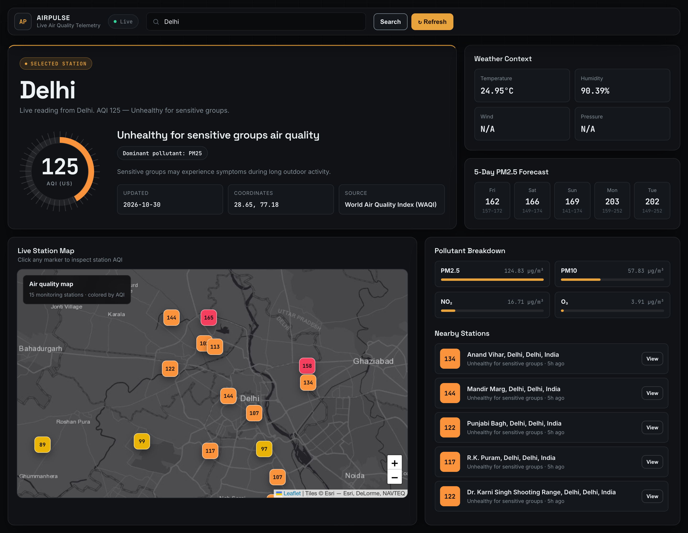
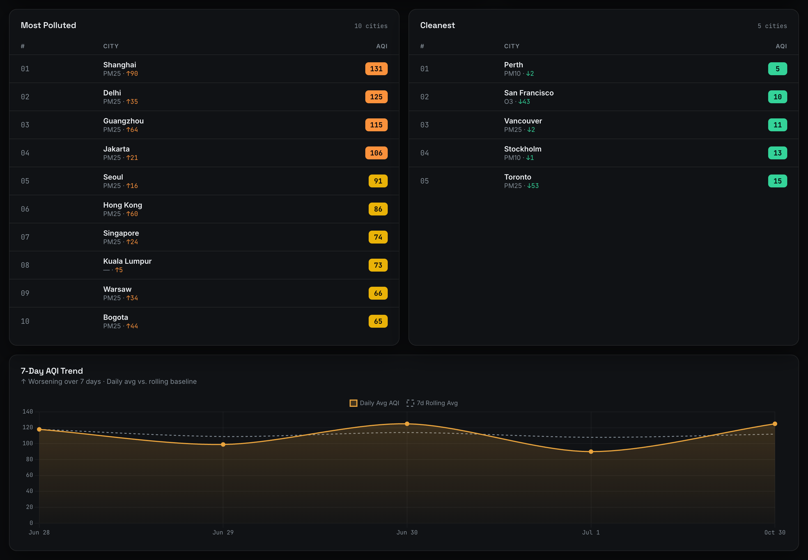
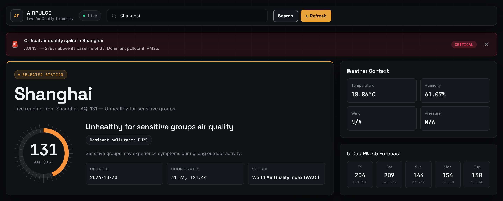
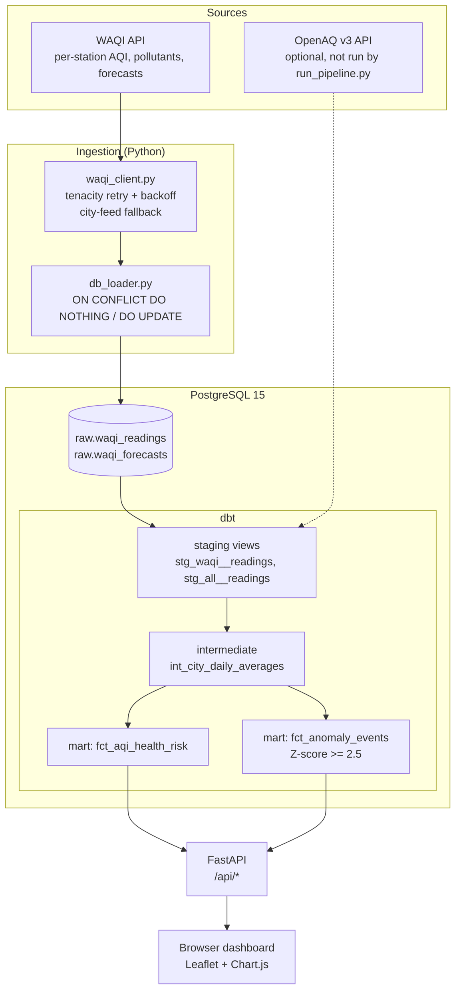
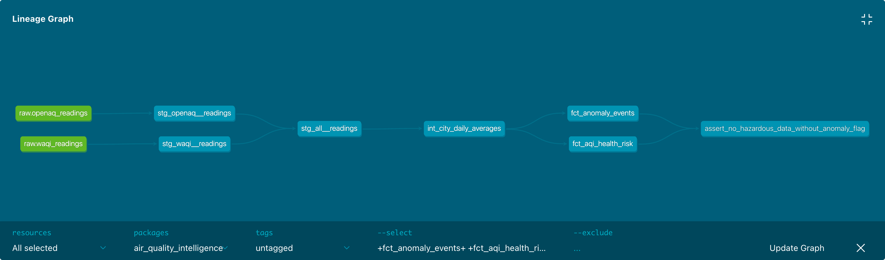

# AirPulse — Live Air Quality Data Pipeline

> Ingests per-station air-quality readings from the WAQI API, models them with dbt into city-level daily marts, flags statistical pollution spikes with a Z-score window function, and serves everything through FastAPI and a live browser dashboard. CI builds and tests the dbt project against a real Postgres.

[](https://github.com/Ajayvarmaramineni/AirPulse/actions/workflows/ci.yml)


**[Project site: architecture, results and screenshots →](https://ajayvarmaramineni.github.io/AirPulse/)** · [Portfolio](https://ajayramineni.com)

The live dashboard needs the FastAPI backend and a database, so the project site shows a snapshot of real pipeline output instead of calling the API.

---

## Screenshots

Captured from a local run (WAQI → PostgreSQL → dbt → FastAPI).

**Station map, gauge, forecast and pollutants**



**Rankings and AQI trend with 7-day rolling average**



**Anomaly alert from the Z-score model**



---

## Results

One full `python run_pipeline.py` against the live WAQI API on **2026-10-30**, with 85 cities configured. Every number below comes from that run's log or from the database afterwards.

| Metric | Result |
|---|---|
| Cities that loaded readings | **77 of 85** (2 returned no data; 6 returned only WAQI's offline `-` sentinel) |
| Station readings fetched | **609** (603 reached the loader) |
| New rows inserted | **584** (19 were already loaded, skipped by `ON CONFLICT DO NOTHING`) |
| Forecast rows upserted | **2,090** across 82 cities |
| Cities that needed the city-feed fallback | **30** (no active stations in their bounding box) |
| Ingestion time | **29.5 min** (0.5 s politeness delay per station plus API latency) |
| dbt | **6 models built, 25 of 25 tests passing** |
| Warehouse after the run | **3,440** raw readings from **708** stations in **79** cities; **218** city-day rows in the marts |
| Anomaly events in the mart | **27** (21 in the last 30 days: 18 Critical, 3 High) |
| Validation warnings | 1 reading with a future timestamp (the run warns and continues) |

Two honest notes on these numbers:

- **The 6 sentinel cities exposed a bug.** The city-feed fallback passed WAQI's `"-"` AQI into an integer column, so the load failed for those cities and logged an error. The client now skips such rows, with tests (`tests/test_waqi_sentinel.py`). Rows loaded are unchanged, since those cities had no usable reading.
- **The anomaly count mostly shows the mechanism, not real pollution events.** 20 of the 27 events are from this run's day. The marts hold only a handful of daily rows per city (four from late June, plus today), so baselines are tiny and Z-scores large. See [Known limitations](#known-limitations).

The trend chart in the screenshot above plots the days that have data: four from the June runs and today's run.

---

## Architecture



### dbt lineage



Generated with `dbt docs generate`. `stg_all__readings` is a UNION model: adding a source means one new staging model and one line in the UNION, and nothing downstream changes.

---

## Key engineering decisions

**Idempotent writes.** Readings are inserted with `ON CONFLICT (station_id, reading_time) DO NOTHING`, so re-running the pipeline never duplicates rows. Forecasts use `ON CONFLICT (city, forecast_day, pollutant) DO UPDATE`, so a newer fetch replaces the old one. Both behaviours are covered by Postgres integration tests that run in CI (`tests/test_db_integration.py`).

**Retry with backoff, then fall back.** Every WAQI call goes through one method wrapped in `tenacity`: 3 attempts, exponential backoff between 2 and 20 seconds, 15-second timeout. When a city's bounding box returns no active stations, the client falls back to WAQI's city feed instead of dropping the city.

**Medallion-style layers.** `raw` (as landed) → `staging` views (clean, type-cast, out-of-range AQI dropped, sources unioned) → `intermediate` (city-day grain plus a 7-day rolling average) → `marts` (`fct_aqi_health_risk`, `fct_anomaly_events`).

**Z-score anomaly detection per city.** A fixed AQI threshold ignores that a normal day in one city is a bad day in another. `fct_anomaly_events` computes each city's mean and standard deviation over up to 29 prior daily rows with a window function (`ROWS BETWEEN 29 PRECEDING AND 1 PRECEDING`) and flags days with Z ≥ 2.5 (Medium ≥ 2.5, High ≥ 3, Critical ≥ 4).

---

## Data quality and testing

- **dbt: 6 models, 25 tests** — `unique` / `not_null` on source and staging keys, `not_null` and `accepted_values` on the mart columns that matter, plus a custom test (`dbt/tests/assert_no_hazardous_data_without_anomaly_flag.sql`) that fails if a Hazardous city-day has no matching anomaly row.
- **pytest: 32 tests** — 29 unit tests (WAQI client with mocked HTTP, sentinel handling, loader row filtering, AQI breakpoint checks) and 3 Postgres integration tests for idempotent loads.
- **CI** (`.github/workflows/ci.yml`) runs three jobs on every push: `ruff`, `pytest` against a Postgres service container, and `dbt build` against a seeded fixture. The fixture (`ci/seed_fixture.sql`) is synthetic: a quiet city and a city with a planted spike. After the build, `ci/assert_pipeline.sql` asserts the spike comes out as a Critical anomaly and a Hazardous day, the quiet city is not flagged, and an out-of-range AQI row is dropped by staging.
- **Validation step** — `run_pipeline.py` runs three SQL checks before dbt (no null AQI, no future timestamps, recent data present). They log warnings and the run continues to dbt, so a bad batch is visible but does not block table creation.
- **Sentinel handling** — the client drops stations reporting `"-"` (offline); staging keeps only AQI values between 0 and 500.

---

## Quick start

Requires Python 3.11 and PostgreSQL 15.

```bash
git clone https://github.com/Ajayvarmaramineni/AirPulse.git
cd AirPulse

python3.11 -m venv .venv && source .venv/bin/activate
pip install -r requirements.txt

createdb airquality
psql airquality -f scripts/init_db.sql

cp .env.example .env
# edit .env: set WAQI_TOKEN (free: https://aqicn.org/data-platform/token/) and POSTGRES_USER

python run_pipeline.py        # ingest -> validate -> dbt run -> dbt test
uvicorn api.main:app --port 8000
# open http://localhost:8000
```

By default `run_pipeline.py` ingests 10 cities. Set `WAQI_CITIES` in `.env` to choose others; the 88 cities in `ingestion/waqi_client.py` get every station in their bounding box. `setup.sh` automates the macOS/Homebrew version of these steps (and also installs Apache Airflow); it is not exercised in CI.

Run the tests:

```bash
pytest                                                    # unit tests
AIRPULSE_TEST_DB=1 POSTGRES_DB=<scratch_db> pytest        # plus Postgres integration tests (use a scratch DB)
```

---

## API

| Method | Endpoint | Description |
|---|---|---|
| `GET` | `/` | Serves the browser dashboard |
| `GET` | `/api/cities` | Latest daily snapshot for every city |
| `GET` | `/api/feed/{city}` | WAQI-shaped feed for one city (AQI, pollutants, forecast) |
| `GET` | `/api/stations/{city}` | Latest station readings for the map |
| `GET` | `/api/city/{city}` | The 30 most recent daily rows for the trend chart |
| `GET` | `/api/forecast/{city}` | Daily PM2.5 / PM10 / O3 forecast |
| `GET` | `/api/leaderboard` | 10 most polluted and 5 cleanest cities (latest reading each, last 3 days only) |
| `GET` | `/api/anomalies` | Anomaly events from the last 30 days |
| `GET` | `/api/anomaly/{city}` | Most recent anomaly for a city in the last 3 days |
| `GET` | `/api/health` | Liveness check |

---

## Project structure

```
ingestion/    waqi_client.py (API client), db_loader.py (idempotent loads), openaq_client.py (optional source)
dbt/          models: staging, intermediate, marts; schema tests; one custom data test
api/          FastAPI app: JSON endpoints + serves the dashboard
dashboard/    index.html: single-file dashboard (Leaflet, Chart.js)
scripts/      init_db.sql (raw schema), export_snapshot.py (JSON for the project site)
ci/           synthetic fixture and assertions used by the dbt CI job
tests/        pytest: unit tests and Postgres integration tests
docs/         GitHub Pages site (index.html), screenshots, snapshot JSON
run_pipeline.py   ingest -> validate -> dbt run -> dbt test
```

---

## Known limitations

- **Anomaly detection needs history.** Z-scores are computed over the daily rows already in the mart. With only a few days of history the baseline is tiny and the standard deviation noisy, so early flags are easy to trigger. The model has no minimum-history guard yet.
- **The pipeline runs on demand.** `run_pipeline.py` is the supported entry point. `airflow/dags/air_quality_pipeline.py` is an early scheduling sketch for the OpenAQ path; it predates the WAQI pipeline and is not maintained or tested.
- **Some WAQI stations are stale.** A station can keep reporting an old timestamp for months (23 of 79 cities had a latest reading older than a week in the run above). The leaderboard and the project site rank only readings from the last 3 days; searching for a city can still open one whose latest reading is old, and the `UPDATED` field shows its date.
- **OpenAQ** is wired into dbt (`stg_openaq__readings`) but `run_pipeline.py` does not ingest it.

---

## Data source

**WAQI, the World Air Quality Index** ([aqicn.org](https://aqicn.org)). Free API token at https://aqicn.org/data-platform/token/.

*Built by Aj Ramineni · [ajayramineni.com](https://ajayramineni.com) · [aramineni@wpi.edu](mailto:aramineni@wpi.edu)*
